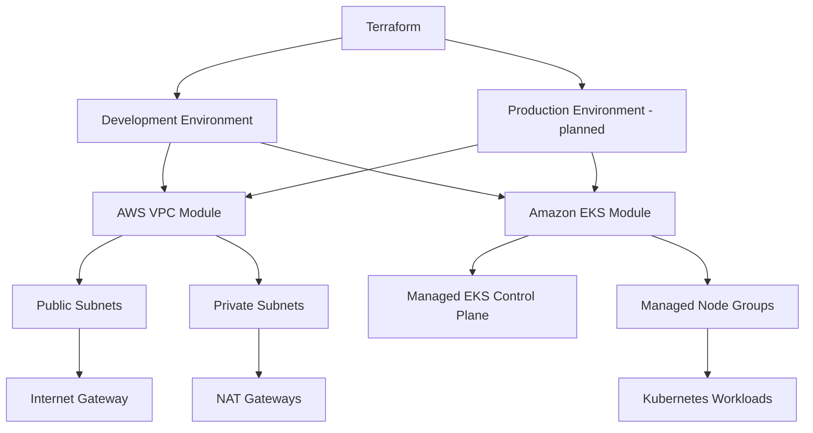

# AWS EKS Infrastructure with Terraform

**Modular Infrastructure as Code for a production-style Kubernetes platform on AWS: VPC, EKS, managed node groups, per-environment configuration.**

[](https://developer.hashicorp.com/terraform)
[](https://aws.amazon.com/)
[](https://aws.amazon.com/eks/)
[](https://kubernetes.io/)

## TL;DR

- Provisions a **multi-AZ VPC** and an **Amazon EKS cluster** from reusable Terraform modules.
- Worker nodes run in **private subnets**; outbound traffic goes through **NAT Gateways**.
- One root module per environment (`dev` today, `prod` planned), with all environment-specific values in `terraform.tfvars`.
- Fully reproducible: `init → validate → plan → apply`, then `kubectl` access in one command.
- Security, cost and observability gaps are documented openly in the [Roadmap](#roadmap) rather than hidden.

## What this project demonstrates

| Skill | Where to see it |
|---|---|
| Infrastructure as Code | Declarative Terraform, version-controlled, reviewed via `plan` |
| Modular design | `modules/network` and `modules/eks` with explicit inputs and outputs |
| AWS networking | VPC, public/private subnets across AZs, IGW, NAT, Kubernetes subnet tags |
| Kubernetes on AWS | EKS control plane, managed node groups, add-ons, OIDC issuer |
| Environment management | Separate root modules and variable files per environment |
| Engineering judgment | Trade-offs documented (HA vs NAT cost, public API endpoint vs hardening) |

## Architecture



The `dev` environment and the reusable network and EKS modules are implemented. The `prod` environment and hardening items are planned (see [Roadmap](#roadmap)).

| Component | Responsibility |
|---|---|
| Amazon VPC | Isolated AWS network |
| Public subnets | Internet-facing resources (load balancers, NAT Gateways) |
| Private subnets | EKS worker nodes and private workloads |
| Internet Gateway / NAT Gateways | Inbound/outbound connectivity for public / private subnets |
| Amazon EKS | AWS-managed Kubernetes control plane |
| Managed Node Groups | EC2 worker nodes managed through EKS |

## Key design decisions

| Decision | Rationale | Trade-off |
|---|---|---|
| Community modules (`terraform-aws-modules/vpc`, `.../eks`) wrapped in local modules | Battle-tested building blocks, with a stable local interface | Dependency on upstream version changes, so versions are pinned |
| Workers in private subnets | Nodes are not directly reachable from the internet | Requires NAT Gateways, which add cost |
| One NAT Gateway per AZ (dev config) | Availability: an AZ failure does not cut egress for the others | Higher hourly and data-processing cost; `single_nat_gateway` is an option for cheaper environments |
| One root module per environment | Independent CIDRs, sizing and policies; smaller blast radius | Some duplication between environments |
| Managed node groups | AWS handles node lifecycle and AMI updates | Less low-level control than self-managed nodes |

## Repository structure

```text
.
├── modules/
│   ├── network/        # VPC, subnets, IGW, NAT, Kubernetes subnet tags
│   │   ├── main.tf
│   │   ├── variables.tf
│   │   ├── outputs.tf
│   │   └── versions.tf
│   └── eks/            # EKS cluster, add-ons, managed node groups
│       ├── main.tf
│       ├── variables.tf
│       ├── outputs.tf
│       └── versions.tf
├── environments/
│   ├── dev/            # Implemented
│   │   ├── main.tf
│   │   ├── variables.tf
│   │   ├── outputs.tf
│   │   └── terraform.tfvars
│   └── prod/           # Planned
├── .gitignore
└── README.md
```

## Modules

### Network (`modules/network`)

Wraps `terraform-aws-modules/vpc/aws`:

- Dedicated VPC with configurable CIDR, DNS support and hostnames
- Public and private subnets distributed across Availability Zones
- Internet Gateway and configurable NAT Gateway topology
- Kubernetes subnet tags for load balancer discovery
- Outputs: VPC ID, subnet IDs and CIDRs, NAT Gateway public IPs

### EKS (`modules/eks`)

Wraps `terraform-aws-modules/eks/aws`:

- Cluster name and Kubernetes version
- VPC and private subnet integration
- Configurable public/private API endpoint access
- Managed add-ons and managed node groups
- Control-plane logging and cluster creator admin permissions
- Resource tags

No environment-specific values are hardcoded in the modules; everything is passed as input variables.

### Environment configuration

Example from `environments/dev/terraform.tfvars`:

```hcl
project_name       = "myapp"
environment        = "dev"
aws_region         = "eu-west-3"
kubernetes_version = "1.33"

vpc_cidr = "10.10.0.0/16"

enable_nat_gateway     = true
single_nat_gateway     = false
one_nat_gateway_per_az = true

endpoint_public_access = true
```

The full file also defines Availability Zones, subnet CIDRs, authorized endpoint CIDRs and node group settings.

## Quick start

**Prerequisites:** Terraform CLI, AWS CLI v2, kubectl, Git, and an AWS account with permissions to create the resources.

```bash
terraform version && aws --version && kubectl version --client
```

**1. Authenticate** (credentials stay outside the code; use short-lived credentials or IAM Identity Center where possible)

```bash
aws configure --profile myapp-dev
export AWS_PROFILE=myapp-dev
aws sts get-caller-identity
```

**2. Deploy**

```bash
cd environments/dev
terraform init
terraform fmt -recursive
terraform validate
terraform plan      # review carefully before applying
terraform apply
```

> Applying changes to an existing cluster can replace nodes or interrupt workloads. Always review the plan first.

**3. Connect to the cluster**

```bash
aws eks update-kubeconfig --region eu-west-3 --name myapp-dev-eks --profile myapp-dev
kubectl get nodes -o wide
kubectl get pods -A
```

The cluster name must match the one configured in Terraform.

**4. Tear down** (to avoid ongoing charges)

```bash
terraform destroy
```

## Terraform outputs

| Output | Purpose |
|---|---|
| `eks_cluster_name` / `eks_cluster_arn` | Cluster identification |
| `eks_cluster_endpoint` | Kubernetes API endpoint |
| `eks_cluster_oidc_issuer_url` | OIDC issuer (for IRSA / workload identity) |
| `vpc_id`, `public_subnet_ids`, `private_subnet_ids` | Network identifiers |
| `nat_gateway_public_ips` | Egress IPs (outbound only, not application IPs) |
| `kubectl_config_command` | Ready-to-run kubeconfig command |

```bash
terraform output
terraform output eks_cluster_name
```

## Security

**In place:**

- Public/private subnet separation, with workers in private subnets
- Configurable EKS API endpoint access
- Credentials kept out of source control
- Resource tagging for ownership and traceability

**Required before production use** (tracked in the roadmap):

- Restrict the public API endpoint to trusted CIDRs, or switch to private-only access
- Least-privilege IAM and a review of EKS access entries
- Workload IAM via EKS Pod Identity or IRSA
- Remote Terraform state with encryption, access control and locking
- Network policies, secrets handling, audit logging
- Periodic review of pinned provider and module versions

## Cost awareness

Resources that incur ongoing charges: EKS control plane, EC2 worker nodes, NAT Gateways and processed traffic, EBS volumes, load balancers, CloudWatch logs. NAT topology (`single_nat_gateway` vs one per AZ) is the main lever between availability and cost. Capacity changes should be based on measured usage, and no savings are claimed without measurement.

## Roadmap

**Done**

- [x] Reusable network module (VPC, subnets, NAT)
- [x] Reusable EKS module (cluster, add-ons, managed node groups)
- [x] Environment-specific variables for `dev`
- [x] Operational outputs

**Next**

- [ ] Production environment configuration
- [ ] Secure remote state backend (encrypted S3 + locking)
- [ ] CI pipeline: `fmt`, `validate`, `plan` on pull requests
- [ ] IAM and EKS access review
- [ ] Resource requests/limits, HPA and node autoscaling
- [ ] Monitoring, logging and alerting
- [ ] Worker sizing and NAT cost optimization
- [ ] Cluster upgrade and disaster recovery documentation

## Author

**Scève Aivanhov Nguetse**, DevOps Engineer (mechanical engineering background in numerical simulation)

[GitHub](https://github.com/aivanhov-dataLab) · [LinkedIn](#) · Open to junior DevOps opportunities in Denmark

---

*Built with Terraform and AWS.*